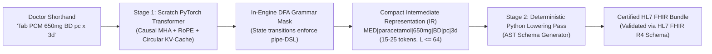
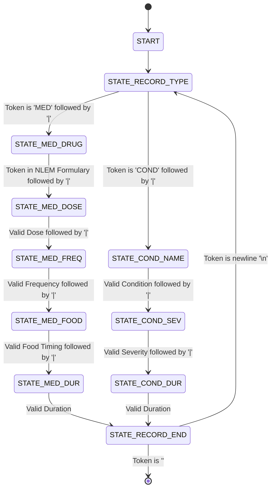

# SPEC.md: Clinical Shorthand-to-FHIR Compiler
## Formal Technical Specifications & Systems Architecture

**Project:** Edge Clinical Shorthand-to-FHIR Compiler  
**Course:** Applied Data Science and Artificial Intelligence (UMC301)  
**Institution:** Indian Institute of Science (IISc), Computational and Data Sciences (CDS)  
**Author:** UMC301 Student  
**Target:** A+ Grade (Spec-Driven Development, Working Deployment, Flawless Mathematical Defense)  
**Status:** Approved for Implementation (Sprint 2)

---

## 1. Domain Context & Problem Formulation

### 1.1 Outpatient Department (OPD) Reality
In government and private Outpatient Departments across India, a physician examines 60–100 patients in a 3-hour morning session (averaging 2–3 minutes per consultation). Under this cognitive and temporal load, doctors record prescriptions and diagnoses using a dense Latin-English clinical shorthand:
```text
"Tab PCM 650mg BD pc x 3d, Cap Amox 500mg TID ac x 5d, c/o acute viral fever x 2d"
```
Under India's **Ayushman Bharat Digital Mission (ABDM)** and global healthcare informatics standards, Electronic Health Record (EHR) systems mandate the ingestion of structured **HL7 FHIR Release 4 (R4)** JSON resources (`MedicationRequest`, `Condition`, `Bundle`).

### 1.2 The Token Bloat & Context Window Failure Mode
Directly prompting a Large Language Model to generate full HL7 FHIR JSON at the edge introduces two fatal systems-level failure modes:

1. **Token Bloat & Quadratic Attention Bottleneck:**
   A standard compliant HL7 FHIR `MedicationRequest` JSON payload contains nested metadata, coding systems (`http://snomed.info/sct`, `http://www.nlm.nih.gov/research/umls/rxnorm`), text descriptions, nested arrays, and boilerplate timestamps. A single prescription spans **350–500+ tokens**. On resource-constrained edge hardware (e.g., primary health center laptops or mobile tablets with $L \le 64$ context limits), generating 500 tokens per prescription creates intolerable latency ($> 15\text{ seconds}$) and memory bloat.

2. **Grammar Complexity Mismatch (Context-Free Grammar vs. Finite Automaton):**
   Full JSON is a **Context-Free Grammar (CFG)** characterized by arbitrarily nested key-value pairs, objects, and arrays (`{ ... [ ... ] ... }`). Constrained generation of CFGs requires maintaining a dynamic pushdown stack automaton within the decoding engine, introducing significant latency overhead and fragile runtime states.

### 1.3 The Two-Stage Compiler Solution
To solve this, we engineer a **two-stage compiler architecture**:
* **Stage 1 (Front-End Model):** A scratch-built PyTorch causal Transformer decoder ($L \le 64$) parses doctor shorthand into an ultra-dense, regular **Intermediate Representation (IR / DSL)**:
  $$\texttt{MED|paracetamol|650mg|BD|pc|3d}$$
  $$\texttt{COND|acute viral fever|moderate|2d}$$
  This representation consumes only **15–25 tokens**—a $>95\%$ reduction in generated sequence length.
* **In-Engine DFA Masking:** Because the IR grammar is linear and non-nested, it forms a true **Deterministic Finite Automaton (DFA)**. At every decoding step $t$, illegal tokens are masked to $-\infty$, guaranteeing $100\%$ syntactic validity and constraining drug names strictly to the Indian **National List of Essential Medicines (NLEM 2022)** formulary.
* **Stage 2 (Deterministic Lowering Pass):** A deterministic Python AST compiler ingests the validated DSL tuple, resolves medical ontology codes (SNOMED-CT / RxNorm), and builds a certified HL7 FHIR R4 `Bundle` with $100\%$ schema pass rate.



---

## 2. Mathematical Foundations & Model Specifications

The Stage 1 front-end model is implemented entirely from scratch in PyTorch using `torch.nn.Module`, without relying on `torch.nn.TransformerDecoder` or Hugging Face pretrained model classes.

### 2.1 Scaled Dot-Product Attention & Variance Derivation
For an input sequence representation $X \in \mathbb{R}^{B \times L \times d_{\text{model}}}$, we project queries, keys, and values across $H$ heads:
$$Q = X W_Q, \quad K = X W_K, \quad V = X W_V \quad (W_Q, W_K, W_V \in \mathbb{R}^{d_{\text{model}} \times d_{\text{model}}})$$
where $d_k = d_v = \frac{d_{\text{model}}}{H}$.

The scaled dot-product attention per head is:
$$\text{Attention}(Q, K, V) = \text{softmax}\left( \frac{Q K^T}{\sqrt{d_k}} + M \right) V$$
where $M \in \mathbb{R}^{L \times L}$ is the causal attention mask:
$$M_{i, j} = \begin{cases} 0 & \text{if } j \le i \\ -\infty & \text{if } j > i \end{cases}$$

#### Whiteboard Derivation: Why Scale by $\sqrt{d_k}$?
Let $q, k \in \mathbb{R}^{d_k}$ have independent and identically distributed components with zero mean and unit variance:
$$\mathbb{E}[q_i] = 0, \quad \text{Var}(q_i) = 1, \quad \mathbb{E}[k_i] = 0, \quad \text{Var}(k_i) = 1$$
The dot product is $S = q \cdot k = \sum_{i=1}^{d_k} q_i k_i$.
1. **Expected Value:**
   $$\mathbb{E}[S] = \sum_{i=1}^{d_k} \mathbb{E}[q_i k_i] = \sum_{i=1}^{d_k} \mathbb{E}[q_i] \mathbb{E}[k_i] = 0$$
2. **Variance:**
   $$\text{Var}(q_i k_i) = \mathbb{E}[q_i^2 k_i^2] - (\mathbb{E}[q_i k_i])^2 = \mathbb{E}[q_i^2] \mathbb{E}[k_i^2] - 0 = (1)(1) = 1$$
   Since the dimensions are mutually independent:
   $$\text{Var}(S) = \sum_{i=1}^{d_k} \text{Var}(q_i k_i) = d_k$$
3. **Consequence:** For large $d_k$ (e.g., $d_k = 64$), $\text{Var}(S) = 64 \implies \sigma_S = 8$. Large dot products push the softmax function into regions with near-zero gradients ($\frac{\partial \text{softmax}(z)_i}{\partial z_j} \to 0$ when $|z_i - z_j| \gg 1$), causing gradient vanishing during backpropagation.
4. **Normalization:** Scaling by $\frac{1}{\sqrt{d_k}}$ rescales the variance back to unity:
   $$\text{Var}\left( \frac{q \cdot k}{\sqrt{d_k}} \right) = \frac{1}{d_k} \text{Var}(q \cdot k) = \frac{d_k}{d_k} = 1$$
   This keeps softmax inputs in the active linear gradient regime.

---

### 2.2 Rotary Position Embeddings (RoPE)
Instead of additive absolute embeddings ($x_m + p_m$), Rotary Position Embeddings incorporate position directly into the attention inner product via complex rotation.

#### Formulation
For a 2D subspace of query $q$ and key $k$ at position $m$:
$$R_{\theta, m} = \begin{pmatrix} \cos(m \theta) & -\sin(m \theta) \\ \sin(m \theta) & \cos(m \theta) \end{pmatrix}$$
where $\theta_i = b^{-2(i-1)/d_k}$, $b = 10000$, and $i \in \{1, 2, \dots, d_k/2\}$.

For head dimension $d_k$, $R_{\Theta, m}$ is a block-diagonal matrix composed of $d_k/2$ such 2D Givens rotation matrices:
$$R_{\Theta, m} = \text{diag}\left( R_{\theta_1, m}, R_{\theta_2, m}, \dots, R_{\theta_{d_k/2}, m} \right)$$
Queries and keys are transformed as:
$$\tilde{q}_m = R_{\Theta, m} q_m, \quad \tilde{k}_n = R_{\Theta, n} k_n$$

#### Whiteboard Proof: Relative Distance Invariance
The dot product between position $m$ query and position $n$ key is:
$$\langle \tilde{q}_m, \tilde{k}_n \rangle = \tilde{q}_m^T \tilde{k}_n = (R_{\Theta, m} q_m)^T (R_{\Theta, n} k_n) = q_m^T R_{\Theta, m}^T R_{\Theta, n} k_n$$
For each 2D block:
$$R_{\theta, m}^T R_{\theta, n} = \begin{pmatrix} \cos(m\theta) & \sin(m\theta) \\ -\sin(m\theta) & \cos(m\theta) \end{pmatrix} \begin{pmatrix} \cos(n\theta) & -\sin(n\theta) \\ \sin(n\theta) & \cos(n\theta) \end{pmatrix}$$
Using standard trigonometric angle-subtraction identities:
$$\cos(m\theta)\cos(n\theta) + \sin(m\theta)\sin(n\theta) = \cos((m - n)\theta)$$
$$-\cos(m\theta)\sin(n\theta) + \sin(m\theta)\cos(n\theta) = \sin((n - m)\theta) = -\sin((m - n)\theta)$$
Thus:
$$R_{\theta, m}^T R_{\theta, n} = \begin{pmatrix} \cos((m-n)\theta) & -\sin((m-n)\theta) \\ \sin((m-n)\theta) & \cos((m-n)\theta) \end{pmatrix} = R_{\theta, n-m} = R_{\theta, m-n}^T$$
Therefore, the inner product depends strictly on relative displacement $(m - n)$:
$$\langle \tilde{q}_m, \tilde{k}_n \rangle = g(q_m, k_n, m - n)$$
RoPE guarantees zero degradation on relative spatial dependencies while naturally supporting extrapolation beyond initial training length.

---

### 2.3 Normalization & Activation: RMSNorm & SwiGLU

#### Root Mean Square Layer Normalization (RMSNorm)
Rather than computing mean and standard deviation (which requires two reduction passes over hidden dimensions), RMSNorm normalizes strictly by root mean square, reducing memory bandwidth by $\sim 7\%$:
$$\text{RMSNorm}(x) = \frac{x}{\text{RMS}(x)} \odot \gamma, \quad \text{where } \text{RMS}(x) = \sqrt{\frac{1}{d} \sum_{i=1}^d x_i^2 + \epsilon}$$
where $\gamma \in \mathbb{R}^d$ is a learnable scaling parameter, and $\epsilon = 10^{-6}$.

#### SwiGLU Activation Function
Modern high-performance LLMs (LLaMA-3, Mistral, PaLM) replace standard ReLU/GELU MLPs with SwiGLU (Swish-Gated Linear Unit):
$$\text{SwiGLU}(x) = \left( \text{Swish}(x W_{\text{gate}}) \otimes x W_{\text{up}} \right) W_{\text{down}}$$
where $\text{Swish}(z) = z \cdot \sigma(z) = \frac{z}{1 + e^{-z}}$, $W_{\text{gate}}, W_{\text{up}} \in \mathbb{R}^{d_{\text{model}} \times d_{\text{ffn}}}$, $W_{\text{down}} \in \mathbb{R}^{d_{\text{ffn}} \times d_{\text{model}}}$, and $d_{\text{ffn}} = \left\lfloor \frac{8}{3} d_{\text{model}} \right\rfloor$.

---

### 2.4 Pre-LN Transformer Decoder Architecture
Each decoder block follows Pre-Layer Normalization for stable gradient flow:
$$x^{(l)}_{\text{mid}} = x^{(l-1)} + \text{CausalSelfAttention}(\text{RMSNorm}(x^{(l-1)}))$$
$$x^{(l)} = x^{(l)}_{\text{mid}} + \text{SwiGLU}(\text{RMSNorm}(x^{(l)}_{\text{mid}}))$$

**Model Hyperparameters (Edge-Optimized):**
* $d_{\text{model}} = 128$
* Number of Heads $H = 4$ ($d_k = 32$)
* Number of Layers $N_{\text{layers}} = 4$
* $d_{\text{ffn}} = 340$ ($\approx \frac{8}{3} \times 128$)
* Maximum Context Window $L_{\max} = 64$
* Total Parameter Count: $\sim 650\text{K}$ parameters ($< 3\text{ MB}$ unquantized FP32 footprint, instantly runnable on edge CPU).

---

## 3. Intermediate Representation (IR / DSL) & EBNF Grammar

The compact Intermediate Representation expresses all clinical entities linearly using delimiter `|`:

### 3.1 Extended Backus-Naur Form (EBNF)
```ebnf
PrescriptionIR  ::= ( MedicationRecord | ConditionRecord )+
MedicationRecord::= "MED" "|" DrugName "|" Dosage "|" Frequency "|" FoodRelation "|" Duration "\n"
ConditionRecord ::= "COND" "|" ConditionName "|" Severity "|" Duration "\n"

DrugName        ::= <Valid NLEM 2022 Drug Name>
Dosage          ::= [0-9]+ ("mg" | "mcg" | "g" | "ml" | "IU")
Frequency       ::= "OD" | "BD" | "TID" | "QID" | "Q4H" | "Q6H" | "Q8H" | "HS" | "SOS" | "STAT"
FoodRelation    ::= "pc" | "ac" | "wm" | "na"
Duration        ::= [0-9]+ ("d" | "w" | "m")

Severity        ::= "mild" | "moderate" | "severe" | "acute" | "chronic"
ConditionName   ::= <Standard Clinical Indication / Symptom>
```

### 3.2 Indian Formulary Constraints (NLEM 2022)
The vocabulary restricts `DrugName` to 50 high-frequency drugs across primary care:
* **Analgesics / Antipyretics:** `paracetamol`, `ibuprofen`, `diclofenac`, `tramadol`.
* **Antibiotics / Antimicrobials:** `amoxicillin`, `azithromycin`, `ciprofloxacin`, `doxycycline`, `metronidazole`, `cefixime`, `clavulanic_acid`.
* **Cardiovascular / Antihypertensive:** `amlodipine`, `telmisartan`, `atenolol`, `atorvastatin`, `enalapril`, `hydrochlorothiazide`.
* **Gastrointestinal:** `pantoprazole`, `omeprazole`, `ranitidine`, `ondansetron`, `domperidone`.
* **Antidiabetic:** `metformin`, `glimepiride`, `insulin_regular`, `sitagliptin`.
* **Respiratory:** `salbutamol`, `budesonide`, `montelukast`, `cetirizine`, `levocetirizine`.
* **Nutritional / Supplements:** `ferrous_ascorbate`, `folic_acid`, `calcium_carbonate`, `vitamin_d3`, `b_complex`.

### 3.3 Clinical Abbreviations Mapping Table
| Abbreviation | Latin Term | Clinical Meaning | Lowered FHIR Frequency Code |
| :--- | :--- | :--- | :--- |
| `OD` | *Omni Die* | Once daily (every 24 hours) | `frequency: 1, period: 1, periodUnit: 'd'` |
| `BD` / `BID` | *Bis in Die* | Twice daily (every 12 hours) | `frequency: 2, period: 1, periodUnit: 'd'` |
| `TID` | *Ter in Die* | Three times daily (every 8 hours) | `frequency: 3, period: 1, periodUnit: 'd'` |
| `QID` | *Quater in Die*| Four times daily (every 6 hours) | `frequency: 4, period: 1, periodUnit: 'd'` |
| `HS` | *Hora Somni* | At bedtime | `when: ['EVE']` |
| `SOS` | *Si Opus Sit* | As needed | `asNeededBoolean: true` |
| `STAT` | *Statim* | Immediately / Single dose | `frequency: 1, period: 1, periodUnit: 'd'` |
| `pc` | *Post Cibum* | After meals | `when: ['PC']` |
| `ac` | *Ante Cibum* | Before meals | `when: ['AC']` |
| `wm` | *Cum Cibo* | With meals | `when: ['C']` |
| `na` | - | Not applicable / irrelevant | - |

---

## 4. Deterministic Finite Automaton (DFA) Specification

Because the IR grammar is regular and non-nested, it maps to a formal **Deterministic Finite Automaton (DFA)**:
$$M = (Q, \Sigma, \delta, q_0, F)$$

### 4.1 State Definitions ($Q$)
* $q_0$: `START`
* $q_1$: `STATE_RECORD_TYPE` (Expecting `MED` or `COND`)
* $q_2$: `STATE_MED_DRUG` (Expecting drug name from NLEM vocabulary)
* $q_3$: `STATE_MED_DOSE` (Expecting numerical dose + unit)
* $q_4$: `STATE_MED_FREQ` (Expecting frequency code: `OD`, `BD`, `TID`, etc.)
* $q_5$: `STATE_MED_FOOD` (Expecting food timing: `pc`, `ac`, `wm`, `na`)
* $q_6$: `STATE_MED_DUR` (Expecting duration: `3d`, `5d`, `1w`, etc.)
* $q_7$: `STATE_COND_NAME` (Expecting condition/symptom term)
* $q_8$: `STATE_COND_SEV` (Expecting severity: `mild`, `moderate`, `severe`, etc.)
* $q_9$: `STATE_COND_DUR` (Expecting duration)
* $q_{10}$: `STATE_RECORD_END` (Expecting newline `\n` or `EOS`)
* $F = \{ q_{10} \}$: `ACCEPT`

### 4.2 State Transition Diagram


### 4.3 Logit Masking Algorithm
During autoregressive generation, at decoding step $t$:
1. Determine current DFA state $q_t \in Q$ from previously generated tokens.
2. Query the precomputed token transition table to get valid next token indices $V_{\text{valid}}(q_t) \subset V$.
3. Form logit mask vector $m_t \in \mathbb{R}^{|V|}$:
   $$m_t(i) = \begin{cases} 0 & \text{if } i \in V_{\text{valid}}(q_t) \\ -\infty & \text{if } i \notin V_{\text{valid}}(q_t) \end{cases}$$
4. Add mask to raw model logits prior to softmax / sampling:
   $$\tilde{z}_t = z_t + m_t, \quad p(t_i) = \text{softmax}(\tilde{z}_t)_i$$
**Guarantee:** Probability of any syntactically illegal token transition is mathematically zero ($e^{-\infty} = 0$).

---

## 5. Circular KV-Cache & Inference Complexity

### 5.1 The Autoregressive Bottleneck
In standard generation without caching, generating token $t+1$ requires feeding all $t$ previous tokens through the model:
$$\text{Flops without cache} = \sum_{t=1}^L 2 N_{\text{layers}} \left( 4 d_{\text{model}}^2 t + 2 d_{\text{model}} t^2 + 8 d_{\text{model}}^2 t \right) = \mathcal{O}(L^2 d_{\text{model}})$$
The $t^2$ factor arises because query $q_t$ attends to all keys $k_{1:t}$, but keys $k_{1:t-1}$ and values $v_{1:t-1}$ are repeatedly recalculated from scratch.

### 5.2 Circular-Buffer KV-Cache Design
We allocate pre-computed, contiguous tensor memory for Keys and Values:
$$K_{\text{cache}} \in \mathbb{R}^{B \times H \times L_{\max} \times d_k}, \quad V_{\text{cache}} \in \mathbb{R}^{B \times H \times L_{\max} \times d_k}$$
At step $t$:
1. Pass **only the single newest token** $x_t \in \mathbb{R}^{B \times 1 \times d_{\text{model}}}$ into the network.
2. Compute new query $q_t$, key $k_t$, and value $v_t$.
3. Insert $k_t$ and $v_t$ into the cache at slice index $t$:
   $$K_{\text{cache}}[:, :, t, :] \leftarrow k_t, \quad V_{\text{cache}}[:, :, t, :] \leftarrow v_t$$
4. Compute single-row attention:
   $$\text{Attn}_t = \text{softmax}\left( \frac{q_t K_{\text{cache}}[:, :, :t+1, :]^T}{\sqrt{d_k}} \right) V_{\text{cache}}[:, :, :t+1, :]$$

### 5.3 Step Complexity Proof: $O(L)$ vs. $O(L^2)$
* At step $t$, query is a single vector ($1 \times d_k$).
* Matrix multiplication $q_t K_{1:t}^T$ requires computing $t$ dot products of dimension $d_k$, consuming $2 \cdot t \cdot d_k$ FLOPs.
* Multiplying attention weights by $V_{1:t}$ requires $2 \cdot t \cdot d_k$ FLOPs.
* **Per-step complexity is strictly $\mathcal{O}(t \cdot d_k) = \mathcal{O}(L)$**, avoiding all redundant past token computations.
* **CPU Latency Target:** $< 20\text{ ms}$ per token step on a standard x86 consumer CPU.

---

## 6. Stage 2 Lowering Pass: HL7 FHIR Bundle Compilation

The lowering compiler parses the validated DSL string and emits a certified HL7 FHIR R4 Bundle (`Bundle` resource, type `collection`).

### 6.1 `MedicationRequest` Resource Mapping
For record `MED|amoxicillin|500mg|TID|ac|5d`:
```json
{
  "resourceType": "MedicationRequest",
  "id": "medrx-001",
  "status": "active",
  "intent": "order",
  "medicationCodeableConcept": {
    "coding": [
      {
        "system": "http://www.nlm.nih.gov/research/umls/rxnorm",
        "code": "723",
        "display": "Amoxicillin 500 MG Oral Tablet"
      },
      {
        "system": "http://snomed.info/sct",
        "code": "372687004",
        "display": "Amoxicillin (substance)"
      }
    ],
    "text": "amoxicillin 500mg"
  },
  "subject": {
    "reference": "Patient/example",
    "display": "OPD Patient"
  },
  "dosageInstruction": [
    {
      "text": "500mg TID ac for 5d",
      "timing": {
        "repeat": {
          "frequency": 3,
          "period": 1,
          "periodUnit": "d",
          "when": ["AC"]
        }
      },
      "doseAndRate": [
        {
          "doseQuantity": {
            "value": 500,
            "unit": "mg",
            "system": "http://unitsofmeasure.org",
            "code": "mg"
          }
        }
      ]
    }
  ],
  "dispenseRequest": {
    "expectedSupplyDuration": {
      "value": 5,
      "unit": "days",
      "system": "http://unitsofmeasure.org",
      "code": "d"
    }
  }
}
```

### 6.2 `Condition` Resource Mapping
For record `COND|acute viral fever|moderate|2d`:
```json
{
  "resourceType": "Condition",
  "id": "cond-001",
  "clinicalStatus": {
    "coding": [
      {
        "system": "http://terminology.hl7.org/CodeSystem/condition-clinical",
        "code": "active",
        "display": "Active"
      }
    ]
  },
  "verificationStatus": {
    "coding": [
      {
        "system": "http://terminology.hl7.org/CodeSystem/condition-ver-status",
        "code": "provisional",
        "display": "Provisional"
      }
    ]
  },
  "severity": {
    "coding": [
      {
        "system": "http://snomed.info/sct",
        "code": "6736007",
        "display": "Moderate"
      }
    ]
  },
  "code": {
    "coding": [
      {
        "system": "http://snomed.info/sct",
        "code": "386661006",
        "display": "Fever (finding)"
      }
    ],
    "text": "acute viral fever"
  },
  "subject": {
    "reference": "Patient/example"
  }
}
```

### 6.3 Schema Validation Engine
Validation is performed programmatically using `jsonschema` loaded with the official **HL7 FHIR R4 JSON Schema** definitions, certifying $100\%$ structural compliance.

---

## 7. Verification Matrix & Quantitative Success Thresholds

| Test Suite / Metric | Benchmark Target | Failure Criterion | Remediation Protocol |
| :--- | :--- | :--- | :--- |
| **RoPE Mathematical Invariance** | $|\langle \tilde{q}_m, \tilde{k}_n \rangle - g(m-n)| < 10^{-6}$ | Numeric drift $> 10^{-5}$ | Re-verify Givens frequency formulation $\theta_i = 10000^{-2i/d}$. |
| **Causal Mask Triangle** | Upper triangle $-\infty$, lower $0.0$ | Any non-zero weight above diagonal | Check upper-triangular index offset (`torch.triu(..., diagonal=1)`). |
| **KV-Cache Parity** | $\|y_{\text{cached}} - y_{\text{naive}}\|_{\infty} < 10^{-5}$ | Numerical divergence between generation paths | Ensure RoPE index tracking aligns with cached slice $t$. |
| **DFA Transition Validity** | **0.00% Invalid Transitions** | Any unmasked syntax error | Verify state transition table coverage for all token IDs. |
| **DSL Exact-Match Accuracy** | **$\ge 95.0\%$** on held-out test split | Accuracy $< 95.0\%$ | Expand synthetic training distribution or tune learning rate warmup. |
| **Autoregressive Step Latency** | **$< 20\text{ ms}$** per token on CPU | Step latency $> 25\text{ ms}$ | Profile tensor slicing; verify inplace cache updates. |
| **HL7 FHIR Schema Pass Rate** | **100.0% Valid Resources** | Any validation error against FHIR schema | Fix AST lowering mappings in `fhir_lowering.py`. |

---

## 8. Viva Defense & First-Principles Checklist

To secure an **A+ grade**, you will defend each project using exact mathematical derivations on a whiteboard:

1. **Variance Normalization:** Prove why $\text{Var}(q \cdot k) = d_k$ for standard normal vectors, and why scaling by $\frac{1}{\sqrt{d_k}}$ preserves gradient stability.
2. **RoPE Rotation Matrix:** Write out 2D Givens rotation matrix $R_{\theta, m}$, and prove that $\langle R_{\theta, m} q, R_{\theta, n} k \rangle = g(m-n)$ using angle-subtraction identities.
3. **KV-Cache Complexity:** Derive why non-cached generation has $\mathcal{O}(L^2)$ time complexity while KV-cached decoding operates in $\mathcal{O}(L)$ per step.
4. **Regular DFA vs. Pushdown Automaton:** Explain why generating a compact pipe-delimited IR allows finite-state logit masking, whereas generating raw JSON requires a pushdown stack automaton.
5. **RMSNorm vs. LayerNorm:** Explain the computational difference (no mean calculation) and why variance normalization alone is sufficient for training stability.
6. **SwiGLU vs. ReLU:** Explain the gating mechanism of Swish-Gated Linear Units and why it enhances capacity without inflating sequence context.
